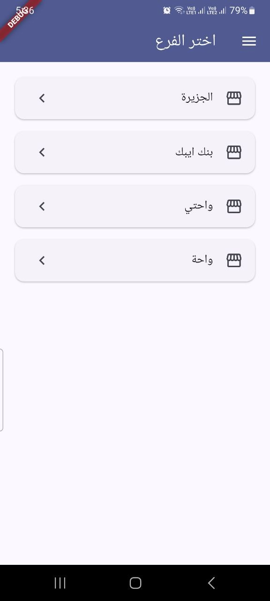
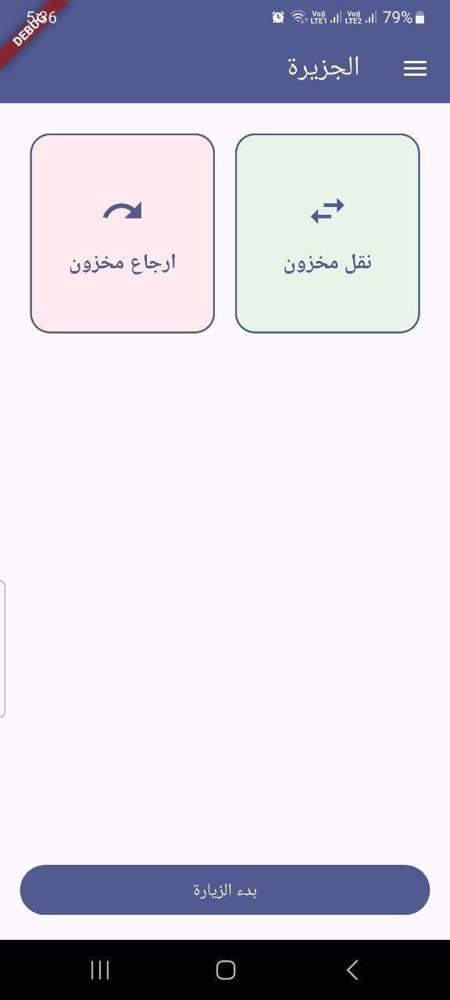
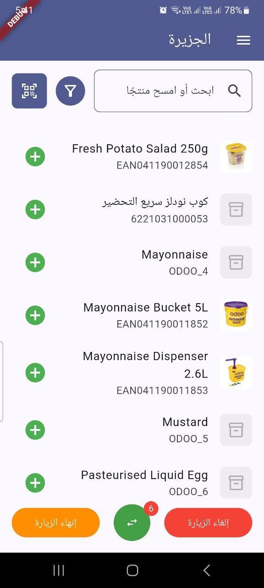
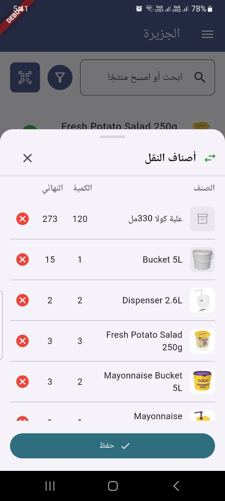
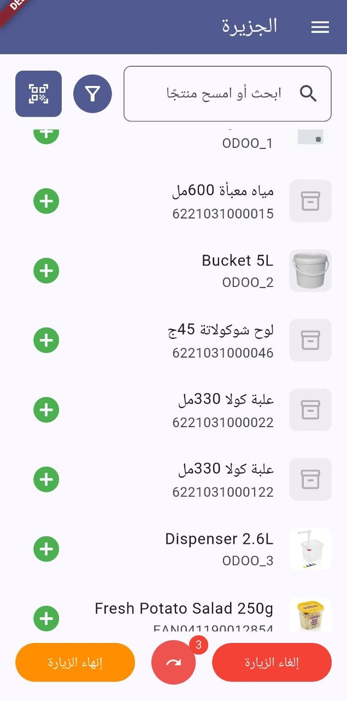
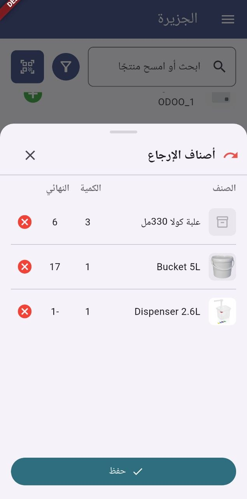
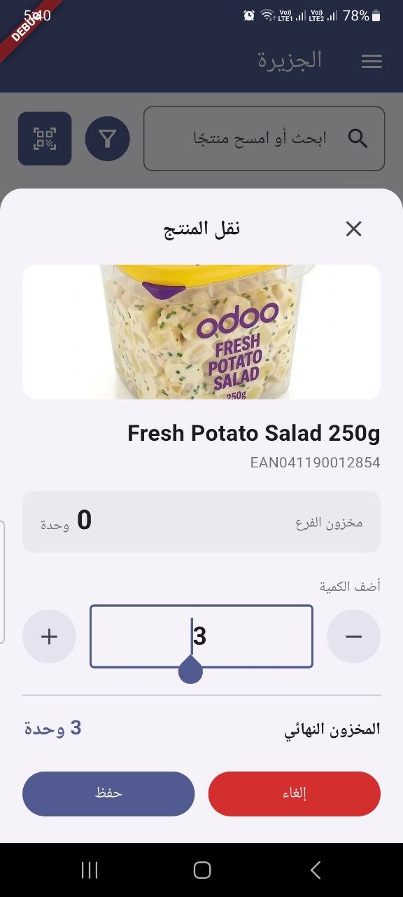
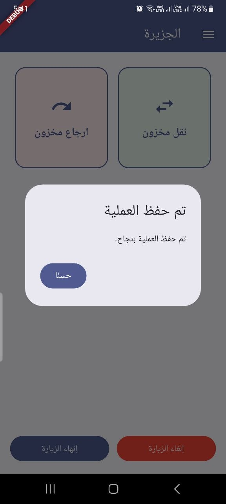
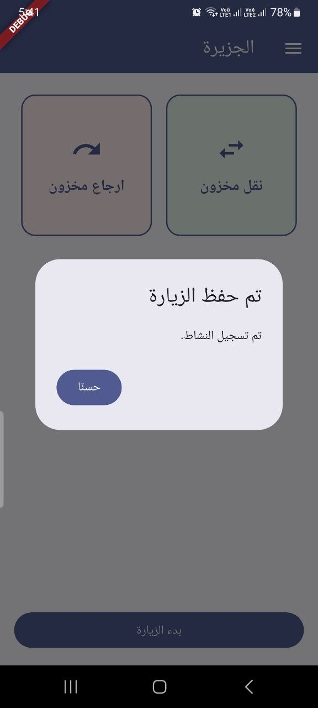

# Waha Ops

Waha Operations — a Flutter app for the branch employee inventory-visit
workflow: pick a branch, start a visit, and record Transfer or Return
operations against it. Full Arabic/English i18n (RTL-aware), built against
the [Waha backend](github.com/MohammadMousa/waha) REST API.

## Flow

Login (auto-login supported) → pick a branch manually → start a visit
(explicit button, or implicitly by picking a process) → Transfer or
Return → search/filter/scan products → save the operation → back to the
branch screen, End Visit when done.

Every Transfer/Return is company↔branch — there's no destination-branch
picker; the only branch in play is the one already selected.

## Screenshots

| | |
|---|---|
| **Pick a branch** — manual, every time, never auto-selected | **Branch home** — Transfer/Return, color-coded, Start Visit |
|  |  |
| **Transfer — product list** — search, filter, scan, real images | **Transfer — staged items** — Qty / Final, aligned columns |
|  |  |
| **Return — product list** | **Return — staged items** |
|  |  |
| **Product filter** — name, barcode, category, description, in-stock | **Quantity popup** — real branch stock, live ending inventory |
|  |  |
| **Operation saved** | **Visit saved** |
|  |  |

## Running [locally]
```
flutter run -d chrome                                          # web
flutter run -d <device-id> --dart-define=API_BASE_URL=http://<lan-ip>:8081   # physical device
```

`API_BASE_URL` defaults to `http://localhost:8081`, which only resolves
correctly on the same machine running the backend — a physical device
needs the dev machine's LAN address instead.

